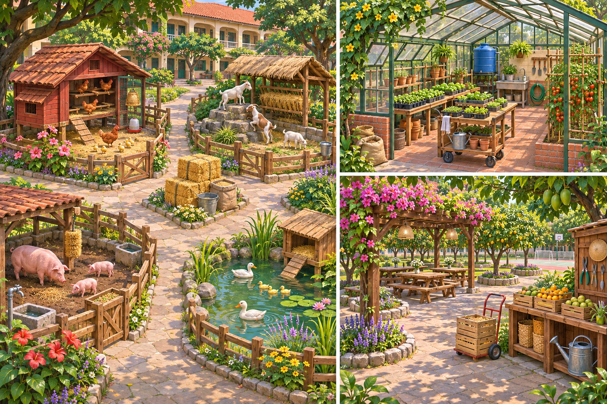

# Learning farm reference

Generated with the built-in ImageGen tool before modelling. The three views guide the animal habitats, propagation room and orchard rest stop.

## Generation prompt

A single full-bleed landscape 3D game environment concept art sheet composed of three adjacent isometric scenes. Cozy, tactile miniature diorama, Vietnamese cadet boarding school's working learning campus for schoolchildren, hand-painted low-poly game art in warm terracotta, deep leaf green, dusty ochre, jade water and sunlit wood, no text or HUD. Most prominent LEFT HALF: four animal habitats clustered around clear stone footpaths, red henhouse with perches and hens and little chicks, straw hay rack and climbing goats, pig yard with brush and piglets, reed pond ducks and ducklings; straw bales with binding, feed bins, buckets, rustic gates and planted flower borders. Top right: lush cutaway greenhouse propagation workshop with tomato trellis, leafy seed trays, work cart, blue water tank, coiled hose and potting sink. Bottom right: outdoor shaded orchard picnic and harvest station, pergola with flowering climbers over picnic tables, fruit crates, hand trolley, tool hooks, tree alleys and ring plantings; outdoor court sidelines visible in distance. Enough open paths for four friends to walk abreast, details clustered into functional work areas. Beautiful considered arrangement, complementary shapes and varied heights, credible proportions, gentle occlusion, soft midday light. Readable from a player camera, close enough to see the animals and tools, no new humanoid characters, no lettering, no borders, no flat UI. Professional indie cozy game environment art direction, high quality detailed scene, 3:2 landscape.
