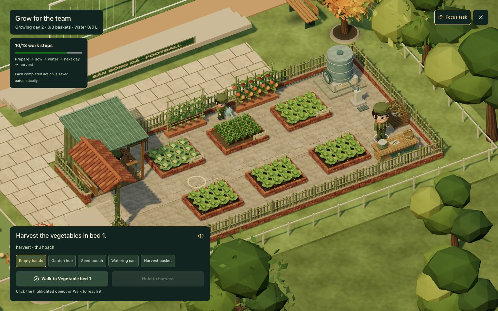
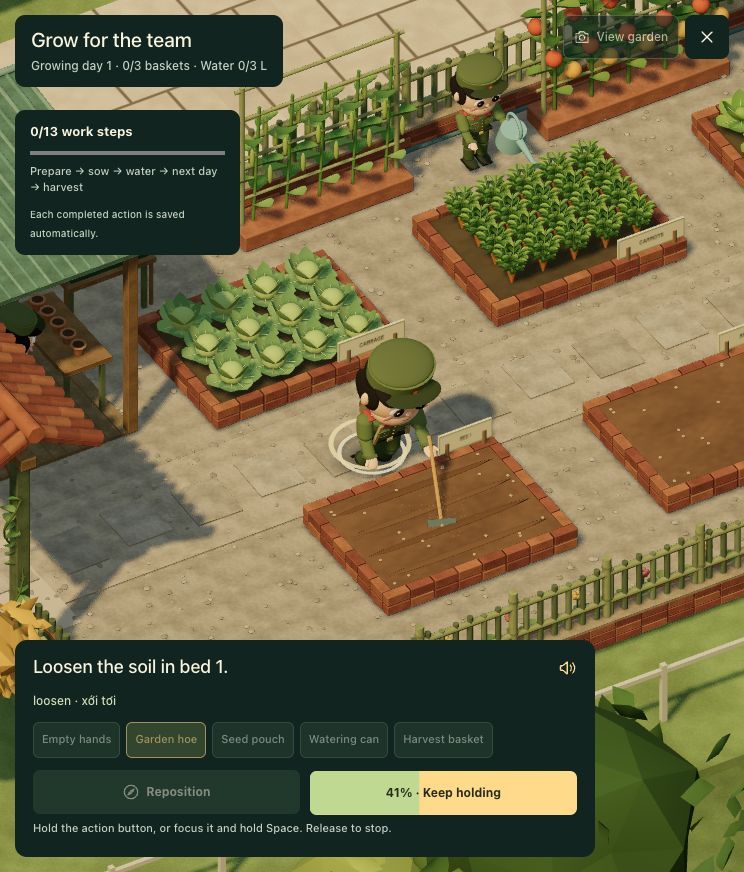
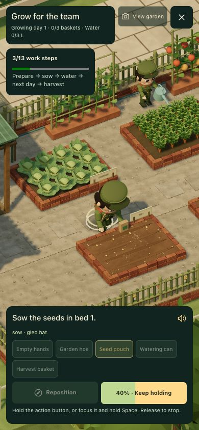
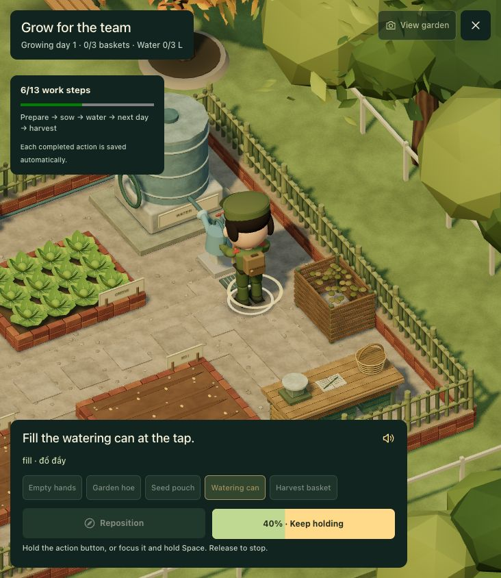
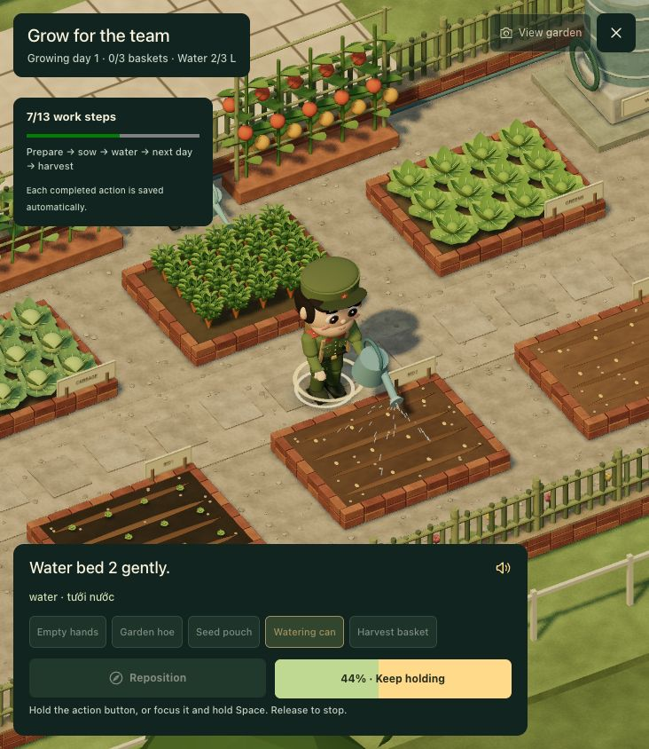
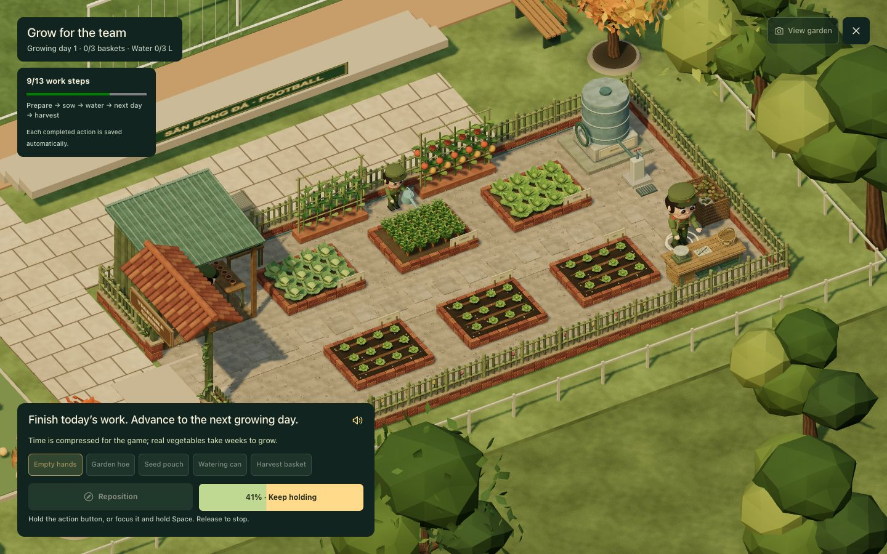
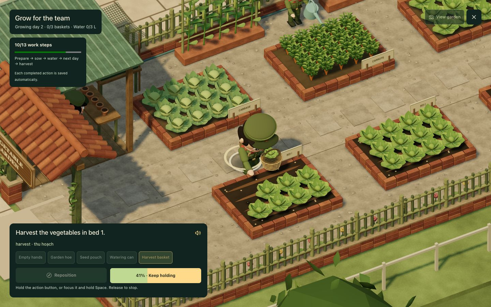
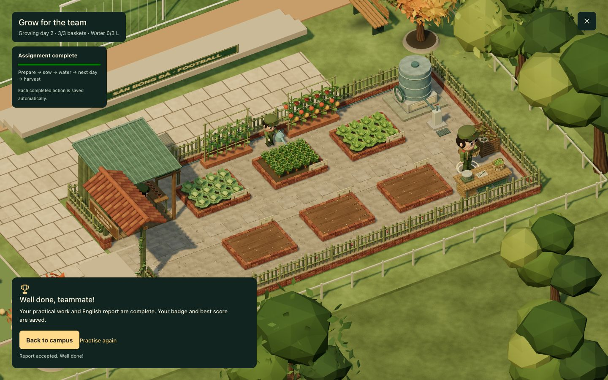

# Garden built from the approved concept

The approved reference is [farm-concept-reference.png](previews/farm-concept-reference.png). The garden is rendered as actual Three.js geometry. The concept image is a design reference, not a background plane replacing the playable environment.

## Layout and art direction

The southeast enclosure now covers 17.8 × 9.1 m (161.98 m²). Its west entrance has a terracotta tile gable, olive timber posts, vines and a cream-lettered wooden plaque. Bamboo gate leaves fold flat against the side fencing, leaving the entrance and potting-shed access clear. Low brick plinths support green bamboo pickets and rails around the perimeter.

An open-front potting shed with a corrugated green roof occupies the northwest corner. It contains shelves, seed packets, sacks, pots, hanging tools and a work counter. The attached nursery has seedling trays under a perforated shade cloth. Rear bamboo supports carry beans and tomatoes. The water tank stands on a masonry base in the northeast corner, with a tap, coiled hose and drain. Compost is stored separately at the eastern edge. A harvest table near the southeast corner has a scale, logbook, pencil, woven baskets and produce crates beneath it. Gravel, stepping pads and brick-edged beds give the garden the material language of the reference.

The six rectangular beds are arranged in two rows. Three rear beds are permanent reserve planting. Three front beds are the interactive mission plots, each with twelve individually animated plants. A 1.65 m central service path separates the rows; the nominal gap between adjacent training plots is 1.2 m. A side path connects the tap, compost area and harvest table.

Two small cadet helpers work at the reserve crops and potting bench. Their poses and watering animation are scenery only: they cannot change the player's work state, reports or XP. Reduced-motion settings keep their poses and remove repetitive motion and particles.

## Direct interaction remains intact

1. Walk to a bed by clicking it in the 3D scene, or use Walk to.
2. Equip the hoe and hold to loosen each bed.
3. Equip seeds and hold to plant. Twelve seed/plant positions appear in each plot.
4. Walk to the new tap and fill the can to 3 L. Watering each plot consumes 1 L, darkens its soil and produces a visible stream from the can.
5. Advance the clearly labelled growing day at the harvest station. Plants scale from sprouts to mature greens.
6. Hold to harvest each bed. Plants disappear individually, a vegetable follows an arc into the held basket and the stored harvest baskets fill.
7. Submit an English report beside the new harvest table. Existing reward rules still prevent repeated XP awards.

View garden switches to a whole-enclosure view; Focus task restores the closer action camera. Players can still click objects and work while viewing the garden. The closer camera looks from the south so the character's face and the work surface are visible.

Stable activity and station IDs preserve old saves. Coordinates changed, but crop stages, water, growing day, reports, badges, best scores and dialogue progress remain compatible.

## Validation

- TypeScript, ESLint, production build and all 27 tests pass.
- The spatial audit passes 756 ordered routes between 28 destinations, including the 12 mission stations, shed entrance and interior aisle. There are 161 solid footprints, with 29 in the garden.
- Audit inspection caught a gate leaf obstructing the shed aisle. Folding both leaves along the fence fixed it; a regression assertion checks entrance-to-aisle travel.
- The entrance plaque has 0.4 m clearance above the cadet cap. A tree previously hiding the plaque was moved away from its viewing axis.
- Full browser run completed all 13 physical steps and an accepted English report. Direct object picking, partial-hold cancellation and save restoration after reload were exercised. Water decreased 3 → 2 → 1 → 0 L; three harvests filled three baskets. XP remained 330, with the same dialogue mission and existing 3/3 activity badges.
- At 390 × 844, the crop, character and action controls remain visible. Planting is completed at this size. Desktop overview and close work views are also checked at 1440 × 900.
- Water particle/stream geometry disables static frustum culling because its vertices move in world space between distant stations. This keeps water visible after travelling from the tap to another bed.

The numerical layout report is [campus-layout-audit.json](campus-layout-audit.json). Motion remains authored procedural animation; crop growth compresses real growing time into a labelled game day.

## Browser evidence

