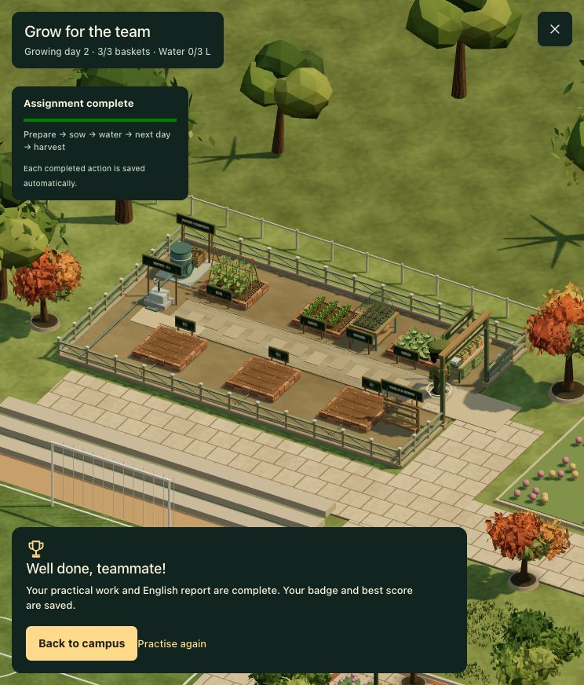
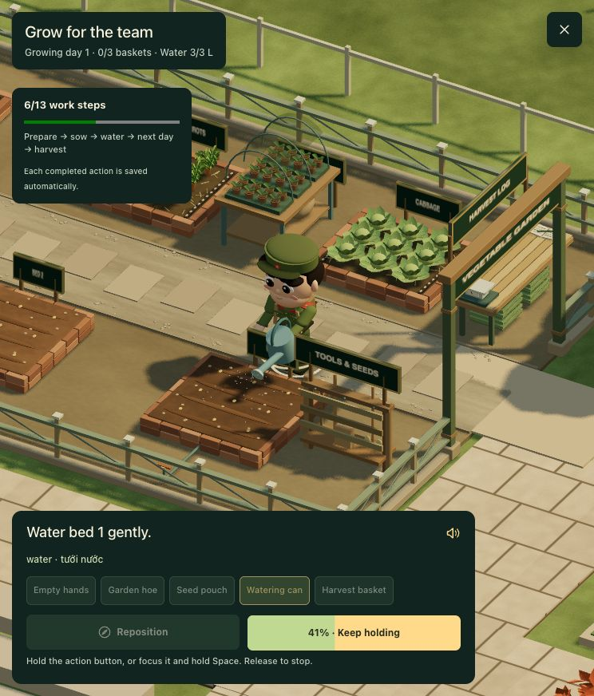
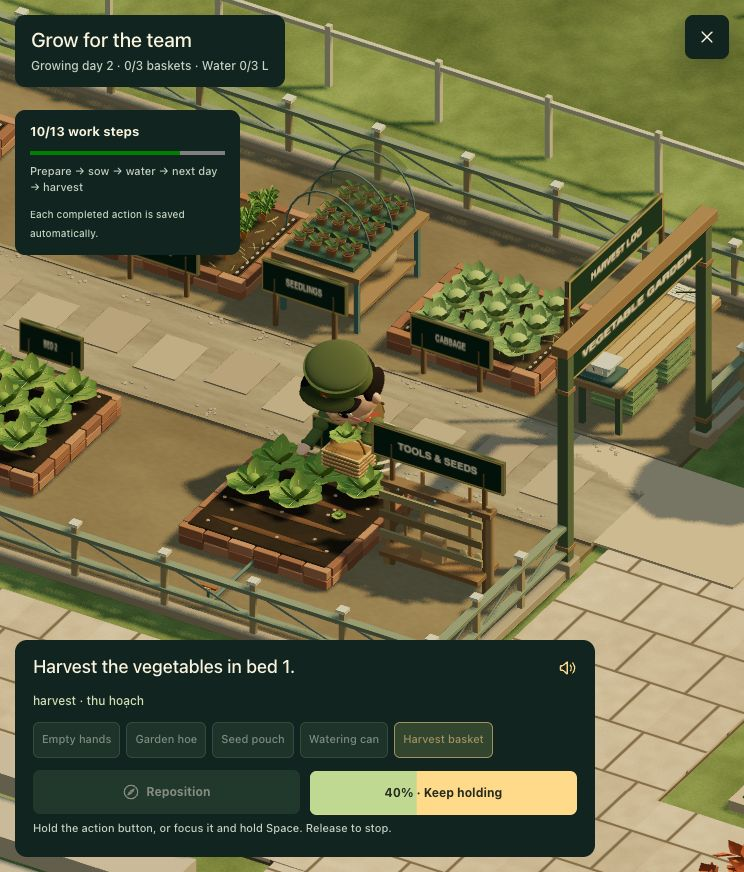
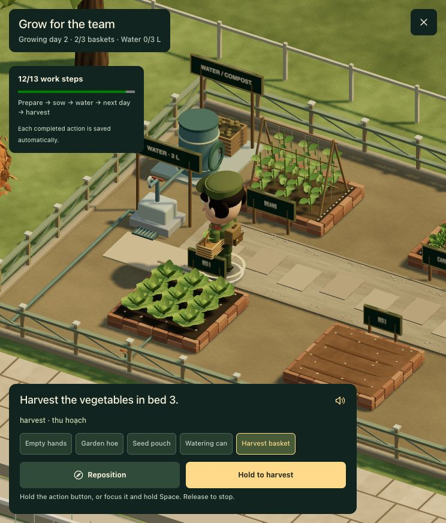
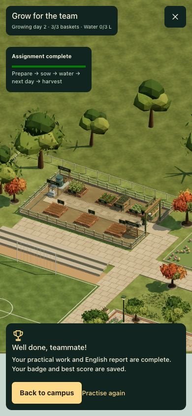

# Vegetable garden: detail and finish pass

The separate southeast district retains its footprint, western entrance and existing mission stations. Existing crop stages, English reports, rewards and saved progress remain compatible.

## Scene changes

- **Beds:** two courses of individual brick edging, mortar gaps, soil-colored rounded furrows, gravel-lined drainage margins and wet soil feedback during watering.
- **Crops:** cupped and veined lettuce for the playable beds. Reserve beds now show cabbage, feathery carrot tops and beans supported by a bamboo trellis, with straw mulch around the first two crops. English crop labels support the learning setting.
- **Nursery:** a raised bench between reserve plots contains three trays, 24 planting pots with paired seed leaves, sacks on the lower shelf, hoop supports and a perforated shade net. Its footprint is shared with navigation and minimap.
- **Water:** perimeter supply pipes, individual bed valves, tank bands, hose reel, tap gauge and drainage grate. These are scene details; the practical task continues to require filling the watering can and watering by hand.
- **Tools:** open slatted rack with hooks, hanging hoes, rake, gloves, seed stock and shelf.
- **Harvest:** slatted tabletop, mechanical scale, open log with pencil, stacked ventilated crates underneath and space for three harvested baskets. Baskets are resized and repositioned to avoid the scale and log.
- **Site:** sturdier entrance frame, post caps and diagonal fence braces, low footings, inset stepping pads, compacted gravel and path edging. The central service aisle and work approaches remain clear.

## Rendering and checks

`src/lib/farm-craft.ts` consolidates the opaque detail pieces into one mesh with vertex colors. Crop geometry is shared between plants of the same kind. The perforated nursery net uses a separate mesh; scene cleanup disposes its texture, geometry and material with the existing resource lifecycle.

The layout audit passes 650 routes between 26 named destinations, with 150 solid footprints including the new seedling bench. All 27 tests, TypeScript, ESLint and the production build pass. Browser QA verifies the actual Three.js scene and remaining watering, day advance, harvesting and English report flow. New crop geometry is tested for finite positions/normals/colors, stems rooted into the soil, planting-cell bounds and distinct crop heights.

Nursery, reserve crops, pipework and scale are scenery; this pass adds no new agricultural task or automatic irrigation mechanic. The existing procedural character animations and compressed growing day remain in use.

## Screenshots

## Current concept revision

This earlier finish pass has been superseded by the approved-concept garden: tiled entrance, bamboo/brick enclosure, open potting shed, two rows of larger beds, raised tank and harvest corner. See [Garden built from the approved concept](farm-concept-implementation.md) for the current layout, mechanics, validation and screenshots.
